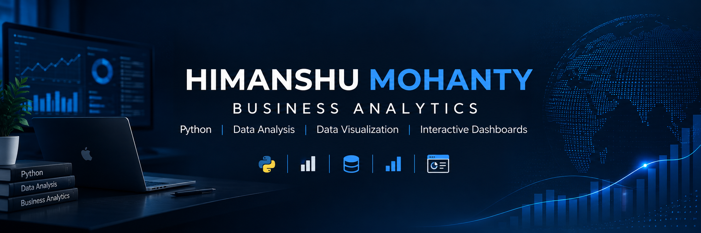

# Hi, I'm Himanshu Mohanty 👋

### Business Analytics | Python | Data Visualisation

I'm a Business Analytics student interested in transforming raw data into meaningful insights through data analysis, visualisation, and interactive dashboards.

I enjoy building practical projects that combine **analytics, business problem-solving, and technology**.

- 📊 Exploring data analytics and business intelligence
- 🐍 Building projects with Python and Pandas
- 📈 Creating interactive dashboards using Streamlit and Plotly
- 🧠 Learning data-driven decision-making and analytical modelling
- 🚀 Continuously learning, building, and improving

---

## 🛠️ Tech Stack

## 🛠️ Tech Stack

### 💻 Programming & Data Analysis

### 📊 Data Visualization & BI

### 🗄️ Databases & Spreadsheets

### ⚙️ Tools & Environment

---

## 🚀 Featured Projects

### 🛍️ ShopEase Analytics Dashboard

An analytics project focused on exploring e-commerce data and presenting business insights through interactive visualisations.

**Tools:** Python, Pandas, Streamlit

[View Repository](https://github.com/H-Mohanty77/shopease-analytics-dashboard)

### 🚗 BYD Digital Transformation Analysis

A business and data analytics case study exploring how BYD uses digital technologies to improve R&D, manufacturing efficiency, customer targeting, and after-sales service. Includes an Excel case analysis and a presentation highlighting business insights and operational risks.

**Tools:** Microsoft Excel, Business Analytics, Data Interpretation

[View Repository](https://github.com/H-Mohanty77/BYD-Digital-Transformation-Analysis)

### ✈️ Airline Tweet Sentiment Analysis

An interactive dashboard that analyses airline-related tweets to explore customer sentiment and visualise patterns in feedback.

**Tools:** Python, Pandas, Streamlit, Plotly, Matplotlib

[View Repository](https://github.com/H-Mohanty77/streamlit-sentiment-dashboard)

---

## 📚 Currently Learning

## 📚 Currently Learning

- 🐍 **Python for Data Analysis** — Pandas, data cleaning, and exploratory data analysis
- 🗄️ **SQL & Database Management** — Queries, joins, aggregations, and PostgreSQL
- 📊 **Business Intelligence** — Excel analysis, KPI tracking, and Power BI
- 📈 **Statistics & Predictive Analytics** — Regression, hypothesis testing, and model evaluation
- 📉 **Data Visualization** — Building interactive dashboards with Streamlit and Plotly
- 💡 **Business Analytics** — Translating data into actionable business insights

---

📊 GitHub Activity

---

## 🤝 Let's Connect

I'm always interested in learning, collaborating on analytics projects, and exploring new ideas.

[My GitHub Profile](https://github.com/H-Mohanty77)

---

*Learning by building. Improving through data. Growing with every project.*
